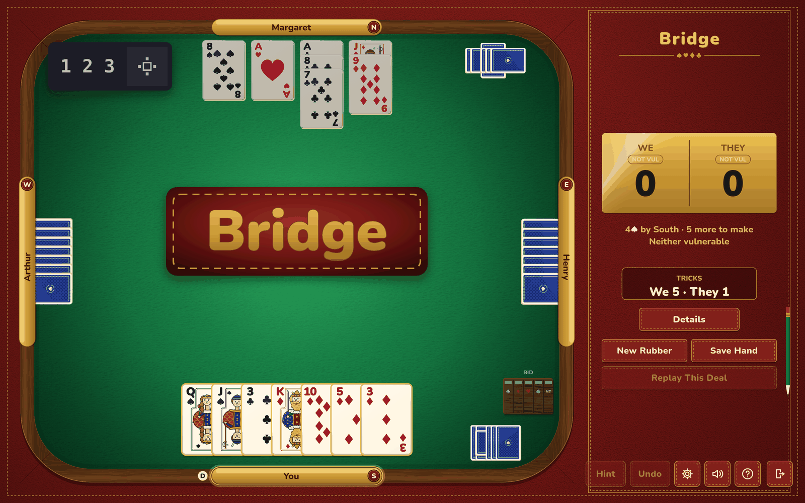

# Bridge

Single-player contract bridge for the Omarchy shell.

You sit South. The computer plays your partner (North) and your two opponents (East and West). Every deal is a fresh shuffle, and you can score by Rubber or Chicago under the Laws of Duplicate Bridge.

Bridge lives in your bar as a small table icon. Click it to open the game in its own window, and click it again to close the window.



## Requirements

- Omarchy 4.x (the Quattro shell with plugin support)
- Chromium, which Omarchy installs by default. Any Chromium-based browser also works (Chrome, Brave, Helium, Vivaldi, Edge).

The game makes no network calls and needs no extra packages and no sudo.

## Install

Install it from the Omarchy plugin marketplace, or run:

```
omarchy plugin add https://github.com/advocu/omarchy-bridge.git --enable
```

The Bridge icon then appears on the right of the bar. If it doesn't, run `omarchy-shell shell rescanPlugins` once so the shell picks up the new plugin.

You can also open or close the game from a terminal or a keybinding:

```
omarchy-shell bridge toggle
```

## Remove

Run:

```
omarchy plugin remove io.github.advocu.bridge
```

If the game is open, removing the plugin closes the game window. Removing it leaves your saved settings and scores in `~/.cache/bridge`, and a small runtime folder in `$XDG_RUNTIME_DIR/bridge`. Delete them by hand if you want them gone:

```
rm -rf ~/.cache/bridge "$XDG_RUNTIME_DIR/bridge"
```

## How to play

1. Press **Start Game**.
2. In the auction, pick a call from the bidding box: a bid, Pass, Double or Redouble.
3. After the auction, the opening lead is made and dummy goes face up. When your side wins the contract, you play both your hand and dummy.
4. Click a card to play it. You must follow suit when you can.
5. The score updates after each deal. Press **Details** for the full scorepad.

Easy, Medium and Hard change how carefully the other three seats bid and play. They never change the deck or the rules. Medium is the default. **Help** in Options lists the bidding system each level uses.

Your game is saved as you play, so you can close the window and pick up where you left off.

## Controls

| Input | Action |
|---|---|
| Click | Make a call or play a card |
| `Esc` | Close the scorepad details |

## What it does on your system

- Opens `game/index.html` (a single self-contained file) in a Chromium app window, with its own browser profile in `~/.cache/bridge/browser`.
- Turns off the browser's background network services for that profile.
- Uses `hyprctl` to float and centre its own window. It doesn't touch your Hyprland config or any other window.
- Closing Bridge, from the bar or by removing the plugin, closes only the game window. If you opened another browser window from the game (for example with `Ctrl+N`), that window stays open. Bridge never kills or signals any process.
- Writes nothing outside `~/.cache/bridge` and `$XDG_RUNTIME_DIR/bridge`.

## License

Copyright (C) 2026 Suyash Verma. All rights reserved.

Bridge is free to install and play through Omarchy, but it is not open source. You may not copy, modify or redistribute it. See `LICENSE`.

The music and the font keep their own licences. See `LICENSES.md`.

## Credits

- Game: Suyash Verma
- Music: "jazz improvisation looped" by Alex McCulloch (Pro Sensory), CC0. "Jazzy blues" by LushoGames, CC0. Both via OpenGameArt.org.
- Font: Nunito, SIL Open Font License 1.1 (full text in `OFL-Nunito.txt`)
